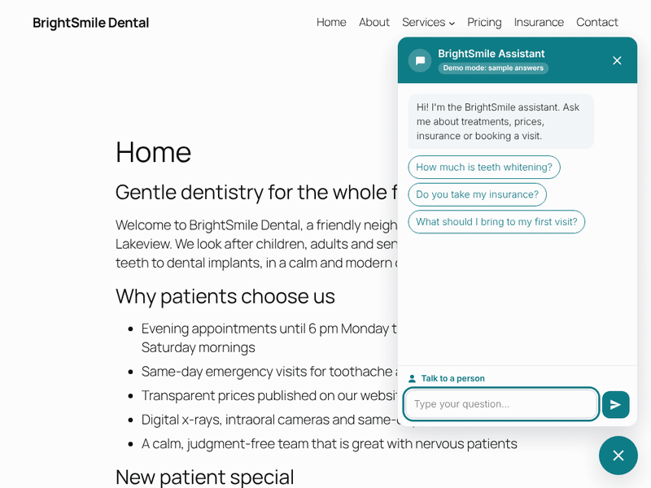
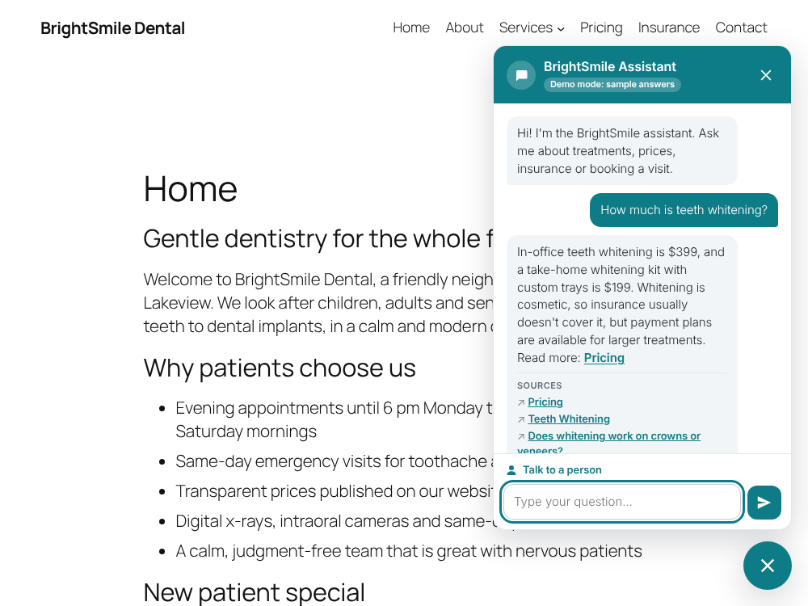
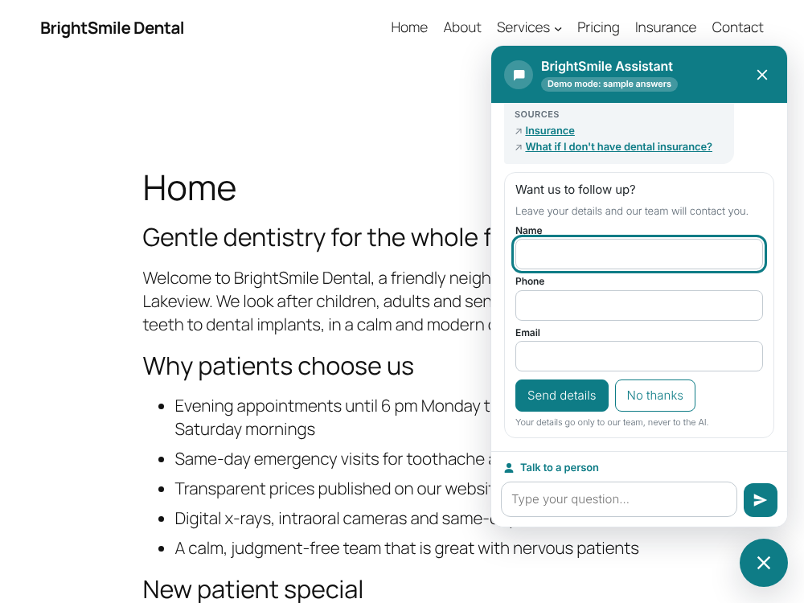
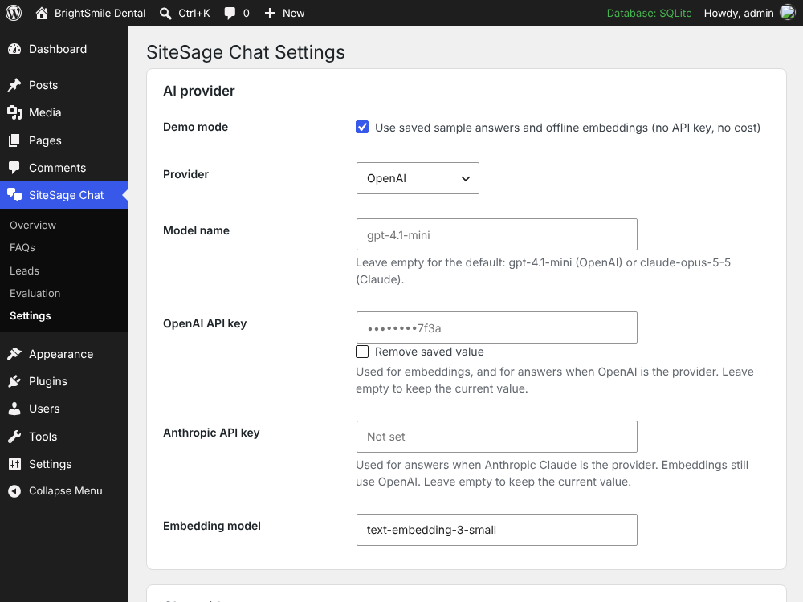
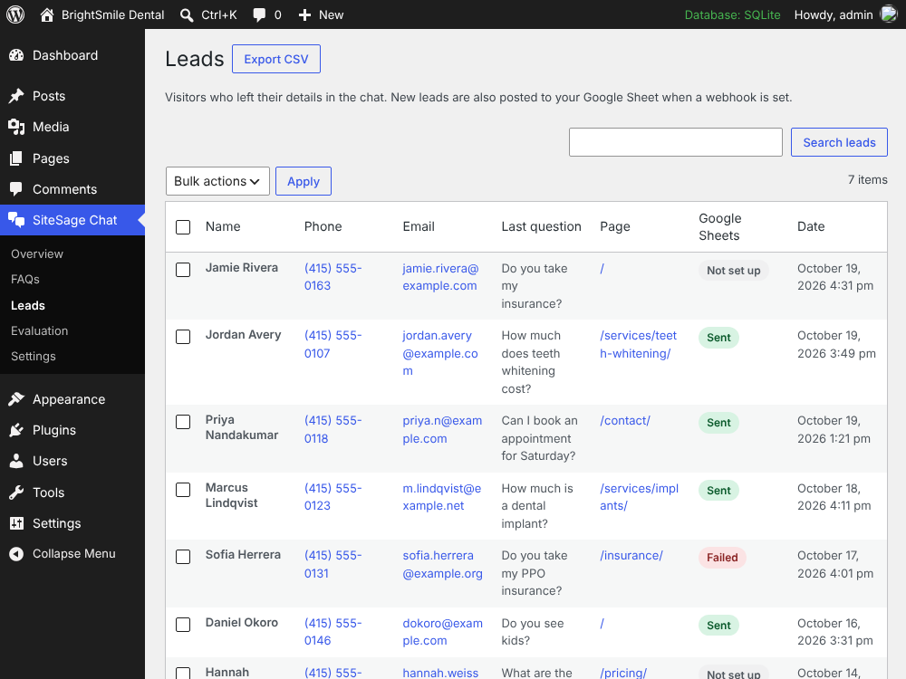
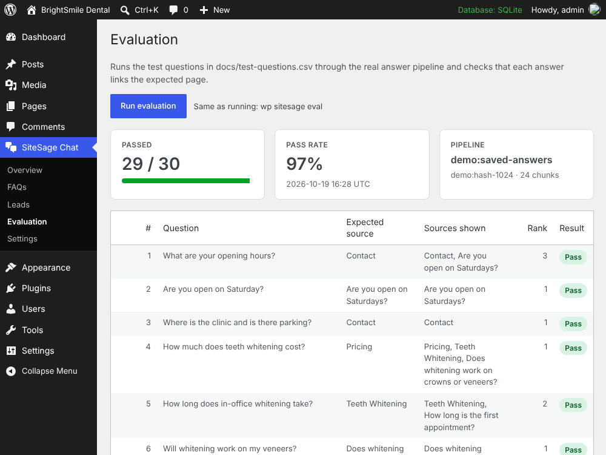
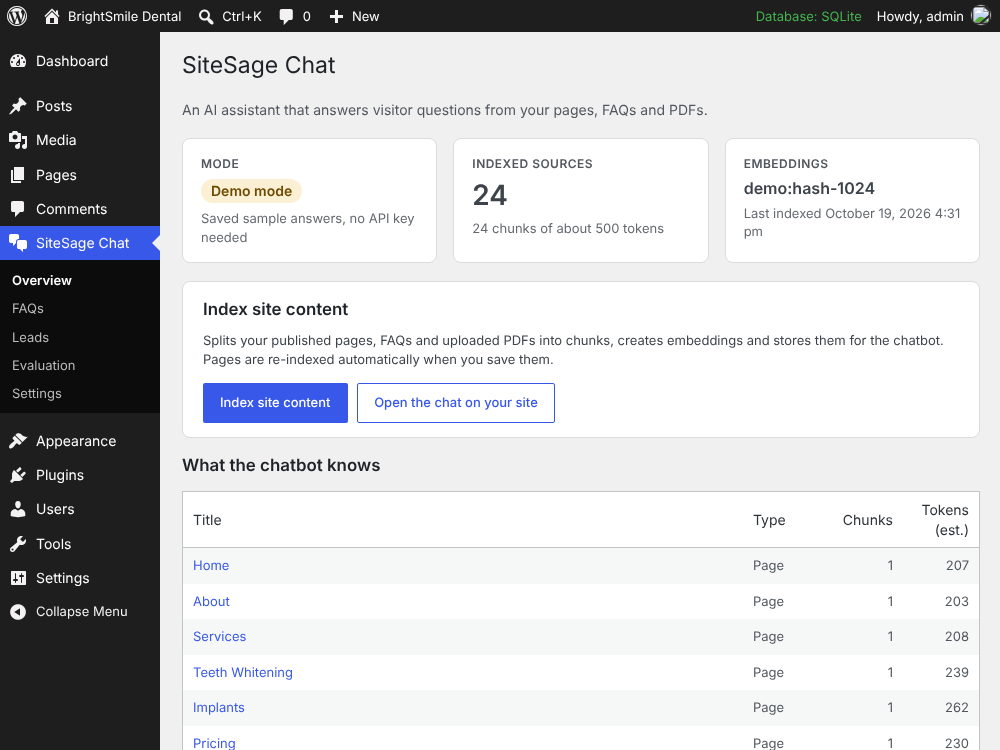
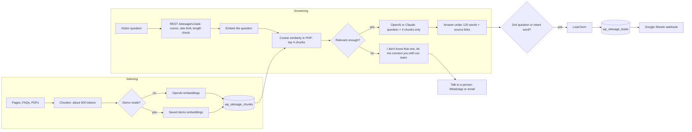

# SiteSage Chat

**A WordPress plugin that adds an AI chatbot trained on your own pages, FAQs and PDFs. It answers in under 120 words, links the page it used, captures leads and hands off to a real person.**

**Live demo:** https://aastha-builds.github.io/wp-ai-site-chatbot/ · **Real plugin in your browser:** [WordPress Playground](https://playground.wordpress.net/?blueprint-url=https://raw.githubusercontent.com/aastha-builds/wp-ai-site-chatbot/main/blueprint.json) · **Video:** see [docs/demo-script.md](docs/demo-script.md) (90-second walkthrough, coming soon)



> Demo project with fictional data. BrightSmile Dental, its staff, phone numbers and prices are made up.

[](https://github.com/aastha-builds/wp-ai-site-chatbot/actions/workflows/ci.yml)

## Features

- **Index site content.** One admin button (or `wp sitesage index`) splits published pages, a FAQ post type and Media Library PDFs into chunks of about 500 tokens, creates embeddings and stores them in `{prefix}sitesage_chunks` with the source URL and title. A page is re-indexed when you save it.
- **Retrieval.** Cosine similarity in plain PHP over the stored vectors, top 4 chunks.
- **Grounded answers.** `POST /wp-json/sitesage/v1/ask`. The system prompt allows only the given context, under 120 words, a link to the source page, and the exact reply *"I don't know that one, let me connect you with our team"* when the context has no answer.
- **OpenAI or Anthropic Claude.** Provider, model name and API keys in Settings. Keys are stored in options and never shown back in full.
- **Chat widget.** Vanilla JS and CSS bubble with brand color, greeting, suggested questions, typing indicator, source links under answers, full screen on phones, keyboard and screen reader friendly.
- **Lead capture.** After 2 questions, or straight away on intent words (book, appointment, price), the chat asks for name, phone and email. Leads go to `{prefix}sitesage_leads`, an admin table with search and CSV export, and a Google Sheets webhook ([Apps Script included](integrations/google-sheets.gs)).
- **Handoff.** A "Talk to a person" button opens WhatsApp or email, as set in Settings.
- **Guardrails.** Nonce on every request, rate limit per IP, max message length, honeypot on the lead form, and only the question plus the retrieved passages are sent to the AI. No chat history, no contact details.
- **Evaluation.** [30 realistic patient questions](docs/test-questions.csv) with the expected source page, and `wp sitesage eval` writes a pass or fail [report](docs/eval-report.md). Current demo result: **29 of 30 passed**.
- **Demo mode.** `DEMO_MODE=true` runs everything without a paid API key, using saved sample answers and saved demo embeddings.

## Screenshots

| Chat on the site | Lead capture |
| --- | --- |
|  |  |
| **Settings** | **Leads** |
|  |  |
| **Evaluation** | **Overview and indexing** |
|  |  |

## Tech stack

- WordPress plugin (PHP 7.4+, WordPress 6.2+): Settings API, REST API, WP-CLI commands, custom post type, custom tables with `$wpdb` and `dbDelta`, `WP_List_Table`
- OpenAI Chat Completions and Embeddings API, Anthropic Claude Messages API (plain `wp_remote_post`, no SDK dependency)
- Retrieval-augmented generation with cosine similarity in PHP
- Vanilla JavaScript and CSS (no build step)
- Google Apps Script webhook
- PHPUnit, WordPress Coding Standards (PHPCS), Node test runner, GitHub Actions
- WordPress Playground blueprint, GitHub Pages

## How it works



## Setup

### Try it without installing anything

Open the [Playground demo](https://playground.wordpress.net/?blueprint-url=https://raw.githubusercontent.com/aastha-builds/wp-ai-site-chatbot/main/blueprint.json). It installs the plugin from this repo, imports the demo content, turns demo mode on and opens the homepage with the chat open.

### Install on a WordPress site

1. Download this repository as a ZIP (or clone it into `wp-content/plugins/sitesage-chat`).
2. **Plugins > Add New > Upload Plugin**, then activate **SiteSage Chat**.
3. Go to **SiteSage Chat > Settings**. Demo mode is on by default. To go live, untick it, choose OpenAI or Anthropic Claude, and add the API keys (an OpenAI key is always needed for embeddings).
4. Add FAQs under **SiteSage Chat > FAQs** if you like, then click **Overview > Index site content**.
5. Optional: run `wp sitesage demo import --with-leads` on a test site to load the BrightSmile Dental demo.

### Local development

Needs PHP 7.4+ with `pdo_sqlite`, [WP-CLI](https://wp-cli.org/) as `wp`, Composer and Node 18+. No MySQL needed.

```bash
git clone https://github.com/aastha-builds/wp-ai-site-chatbot.git
cd wp-ai-site-chatbot
cp .env.example .env          # optional: add API keys, or keep DEMO_MODE=true
composer install              # PHPUnit and coding standards
bin/local-wp.sh setup         # WordPress + SQLite in ./.wp, plugin linked, demo imported
bin/local-wp.sh serve         # http://localhost:8080/?sitesage_open=1  (admin / password)
```

Run the checks:

```bash
vendor/bin/phpunit            # 74 unit tests
vendor/bin/phpcs              # WordPress Coding Standards
npm test                      # GitHub Pages matcher and widget tests
bin/integration-test.sh       # end-to-end in a throwaway WordPress
wp --path=.wp sitesage eval   # writes docs/eval-report.md
```

To preview the GitHub Pages site locally: `cd docs && python3 -m http.server 8090`, then open http://localhost:8090.

## Environment variables

Used by `bin/local-wp.sh` and read by the plugin with `getenv()` when the matching setting is empty. On a normal site, use the Settings screen or `wp-config.php` constants instead.

| Variable | Default | Purpose |
| --- | --- | --- |
| `DEMO_MODE` | `true` | `true` runs on saved sample answers and saved demo embeddings, no API key |
| `SITESAGE_PROVIDER` | `openai` | `openai` or `anthropic` |
| `SITESAGE_MODEL` | empty | Model name. Empty means `gpt-4.1-mini` (OpenAI) or `claude-opus-5-5` (Claude) |
| `OPENAI_API_KEY` | empty | Embeddings, and answers when the provider is OpenAI |
| `ANTHROPIC_API_KEY` | empty | Answers when the provider is Anthropic Claude |
| `WP_PORT` | `8080` | Port for `bin/local-wp.sh serve` |

`wp-config.php` constants: `SITESAGE_DEMO_MODE` (forces demo mode on or off and locks the checkbox), `SITESAGE_OPENAI_API_KEY`, `SITESAGE_ANTHROPIC_API_KEY`.

## Demo mode

Demo mode lets anyone run the full plugin, including Playground and CI, without a paid API key:

- **Embeddings** come from [`demo/demo-embeddings.json`](demo/demo-embeddings.json): saved vectors for the demo content, made by a small built-in hashed TF-IDF embedder. Text that is not in the file (an edited page, a visitor question) is embedded locally with the same method. It matches keywords and a short synonym list; it does not understand meaning the way OpenAI embeddings do.
- **Answers** come from [`demo/sample-answers.json`](demo/sample-answers.json): saved sample AI responses for the 30 test questions. The demo provider receives exactly what a live model receives (system prompt, the 4 retrieved passages and the question) and returns the saved answer when the question matches and its source page was retrieved. Other questions get a short extract from the best passage, or the "I don't know" reply.
- Retrieval, the relevance threshold, source links, lead capture, rate limits and the evaluation all run the real code paths.
- The chat header shows "Demo mode: sample answers" so nobody mistakes it for a live model.

WP-CLI helpers: `wp sitesage demo import [--with-leads] [--remove-sample-content]` and `wp sitesage demo save-embeddings`.

## WP-CLI commands

| Command | What it does |
| --- | --- |
| `wp sitesage index` | Rebuild the index |
| `wp sitesage ask "<question>"` | Ask from the terminal, prints the answer, sources and top score |
| `wp sitesage eval [--csv=<file>] [--report=<file>]` | Run the test questions, write the Markdown report (default `docs/eval-report.md`) |
| `wp sitesage status` | Mode, provider, embedding model and index size |
| `wp sitesage demo import` | Import the BrightSmile Dental demo and index it |

## For developers

Filters: `sitesage_system_prompt`, `sitesage_fallback_message`, `sitesage_min_score`, `sitesage_index_documents`, `sitesage_widget_config`, `sitesage_client_ip`, `sitesage_openai_chat_body`, `sitesage_anthropic_body`. Action: `sitesage_lead_saved`.

```
sitesage-chat.php          Plugin bootstrap
includes/                  Plugin classes (indexer, retriever, providers, REST, admin, CLI)
assets/                    Widget and admin CSS/JS (no build step)
demo/                      Fictional demo content, PDF, saved answers and embeddings
integrations/              Google Apps Script for the Sheets webhook
docs/                      GitHub Pages site, test questions, eval report, scripts
screenshots/               1000x750 screenshots of the real plugin
tests/                     PHPUnit and Node tests
bin/                       Local WordPress, integration test, demo data builders
blueprint.json             WordPress Playground blueprint
```

## Known limits

- Retrieval is a brute-force cosine scan in PHP. It is fast for a few thousand chunks (a typical small-business site). Large sites should move vectors to a vector database.
- Demo-mode embeddings are keyword based. With a live OpenAI key, retrieval uses real semantic embeddings.
- PDF text extraction covers text-based PDFs with standard fonts. Scanned PDFs and CID/Unicode-mapped fonts need a full parser or OCR.
- "Index site content" runs in one request. For hundreds of pages with a live API, use `wp sitesage index` to avoid PHP timeouts. Re-indexing on save calls the embeddings API while the page saves.
- The chat nonce is printed in the page. Full-page caches should be set to refresh pages at least every 12 hours.
- The rate limit uses `REMOTE_ADDR`. Behind a proxy or CDN, pass the real IP with the `sitesage_client_ip` filter.
- Each question is answered on its own (no chat memory). This keeps prompts small and private, but follow-up questions like "and for kids?" need the full question.
- Prompts and the demo tokenizer are English. All interface strings are translation-ready (`languages/sitesage-chat.pot`).
- Not tested on multisite.

## How this can be adapted for your business

- **Clinics, salons, gyms:** answer prices, insurance and opening hours from your own pages, and capture bookings as leads.
- **Law firms and accountants:** intake questions from practice-area pages, with handoff to a person for anything sensitive.
- **Real estate and hotels:** answers from listing and amenity pages, leads straight into your sheet or CRM.
- **SaaS and agencies:** a support bot over docs and FAQs that says "I don't know" instead of inventing answers.
- **WooCommerce stores:** index product and policy pages so shipping and returns questions get linked answers.
- **Your stack:** swap the Google Sheets webhook for HubSpot, Zoho or a Zapier hook, add a Calendly link to the handoff, or add another AI provider behind the same interface.

## License

[MIT](LICENSE)
